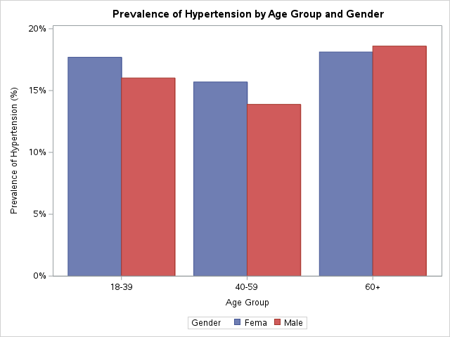
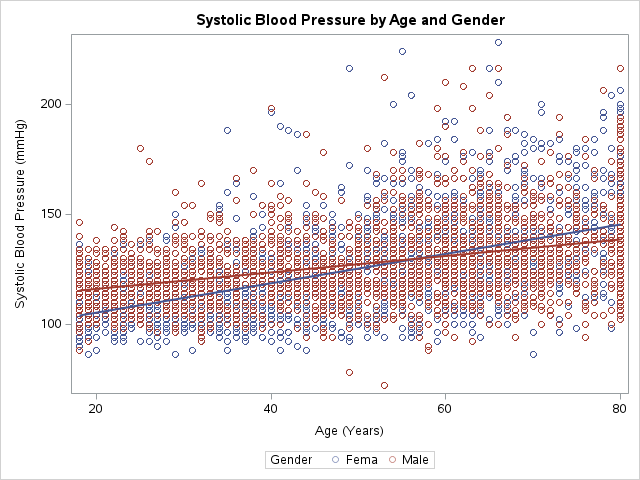
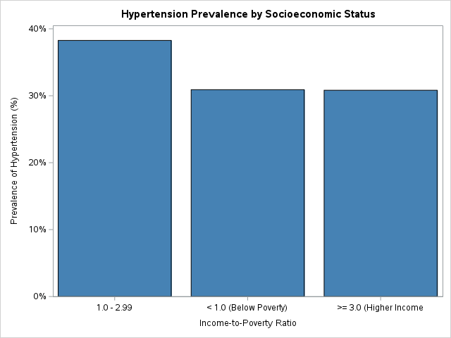

# NHANES Hypertension Risk Analysis (SAS)

## 📌 Project Overview
This project analyzes data from the CDC's National Health and Nutrition Examination Survey (NHANES 2017-2018) to identify independent predictors of hypertension in U.S. adults. 

## 🛠️ Skills Demonstrated
- **Data Wrangling in SAS:** Imported and merged SAS Transport (XPT) files, handled missing data, and recoded raw numeric variables into descriptive categorical factors.
- **Complex Survey Methodology:** Applied survey weights (`WTMEC2YR`), strata (`SDMVSTRA`), and clusters (`SDMVPSU`) to ensure nationally representative estimates.
- **Statistical Modeling:** Performed multivariable survey-weighted logistic regression using `PROC SURVEYLOGISTIC`.
- **Data Visualization:** Created publication-ready plots using `PROC SGPLOT` to visualize trends across age, gender, and income brackets.

## 📊 Key Findings
After adjusting for age, gender, race, and income, the following factors were found to be independent predictors of hypertension:
- **Age:** Every 1-year increase in age increases the odds of hypertension by 4.4% (OR = 1.044, p < .0001).
- **Gender:** Females have 48% lower odds of hypertension compared to males (OR = 0.520, p < .0001).
- **Race:** Non-Hispanic Black individuals have 75% higher odds of hypertension compared to Non-Hispanic Whites (OR = 1.751, p < .0001).
- **Socioeconomic Status:** Individuals living below the poverty line (< 1.0 ratio) have 28% higher odds of hypertension (OR = 1.281, p = 0.0096).

## 📁 Files
- `nhanes_analysis.sas`: The complete SAS code for cleaning, visualization, and modeling.
- `NHANES_Regression_Results.html`: The full statistical output.
  
## 📈 Visualizations

**Hypertension Prevalence by Age and Gender**

**Systolic Blood Pressure by Age**

**Hypertension by Socioeconomic Status**

